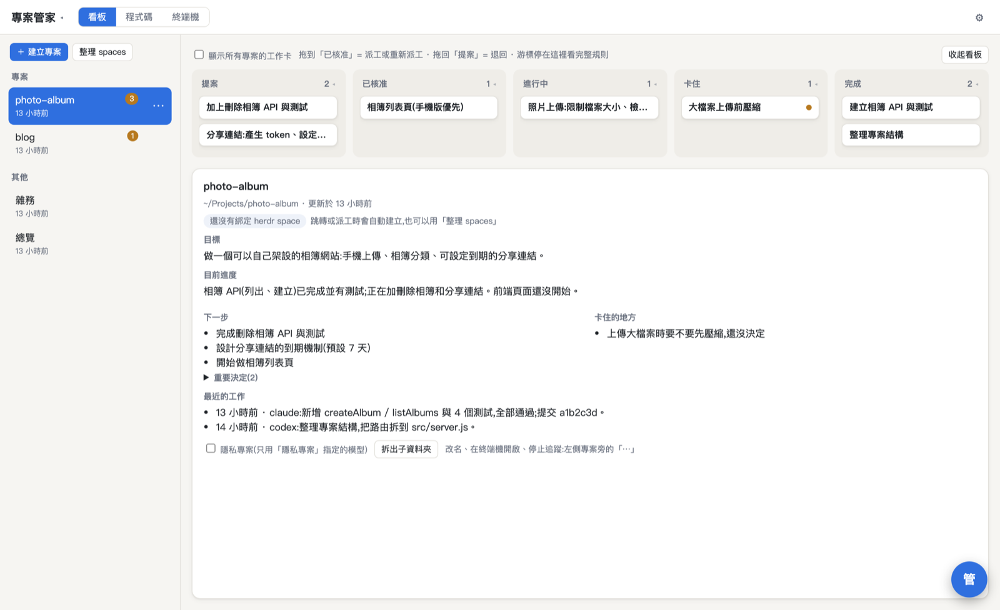
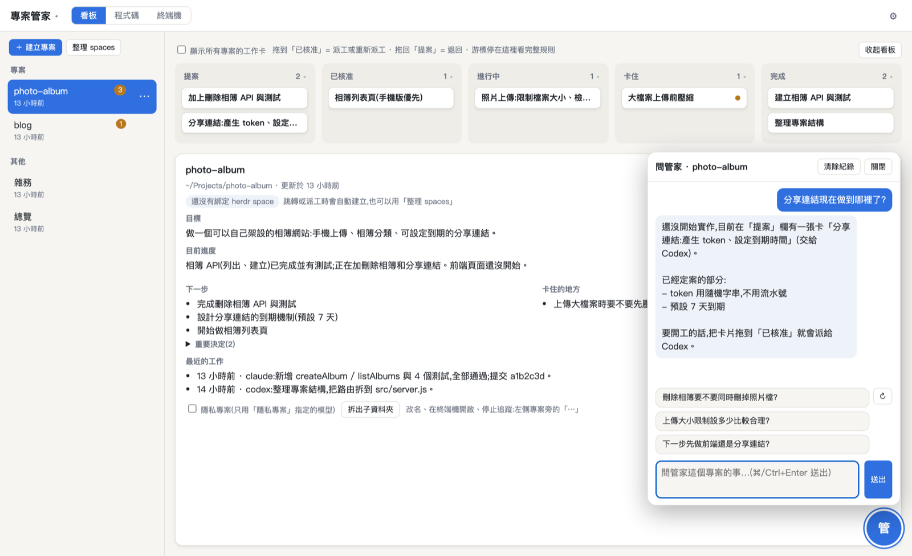
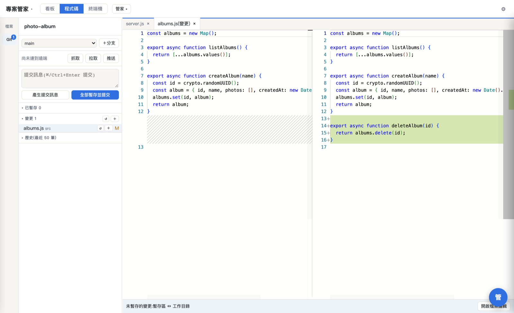
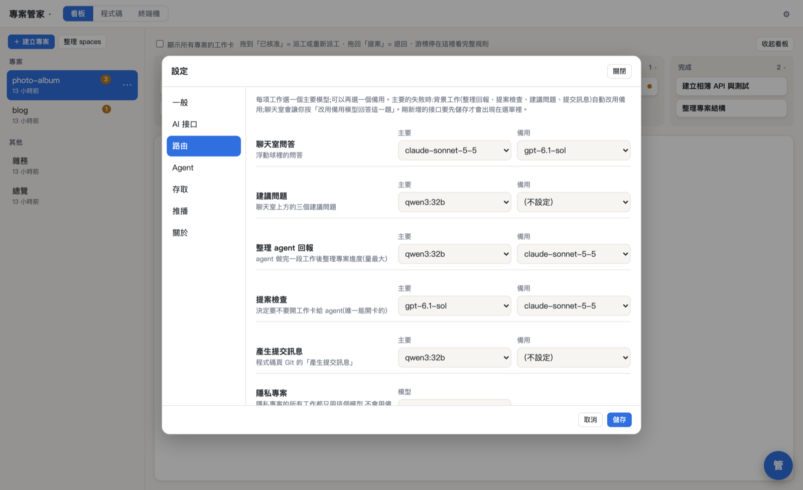
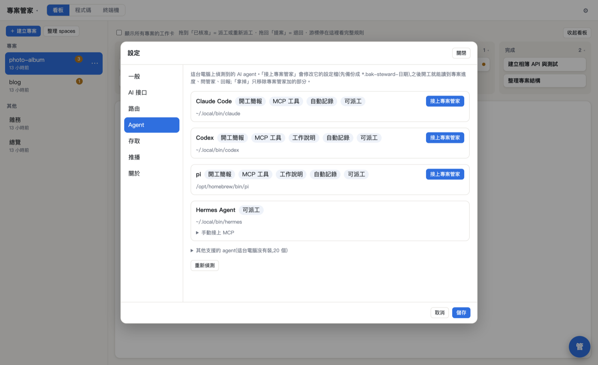
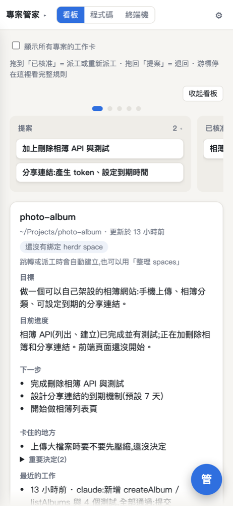

# agent-steward

[繁體中文](README.md)

When you juggle several AI coding agents (Claude Code, Codex, pi, opencode, Gemini CLI…) across several projects,
it is easy to lose track of where each project stands, who is doing what, and what is blocked. agent-steward:

- **Records progress automatically**: when an agent finishes a chunk of work, the steward reads its terminal output and keeps each project's goal, progress, next steps and blockers up to date.
- **Briefs agents on start**: an agent starting work in a project gets the latest state, so you don't have to repeat yourself.
- **Dispatches from a kanban board**: the steward proposes work cards; drag one to "Approved" and it opens a terminal and hands the task to the chosen agent. Once a card is done (or stuck), you can **ask follow-up questions** right in the card; they go to the agent that did the work, and the questions and full replies stay as a thread.
- **Answers questions**: a floating chat button lets you ask "where is this project at?" any time.
- **Works in the browser**: board, code (editor, Git, diff) and terminal in one web page, usable from phones and tablets.



| Ask the steward | Code and Git |
|---|---|
|  |  |

| AI providers and routing | Detect and connect agents | Mobile |
|---|---|---|
|  |  |  |

> The UI is currently Traditional Chinese only.

## Install

**macOS / Linux** (terminal):

```sh
curl -fsSL https://github.com/hao-github-0216/agent-steward/releases/latest/download/install.sh | sh
```

**Windows** (PowerShell, no administrator rights needed):

```powershell
irm https://github.com/hao-github-0216/agent-steward/releases/latest/download/install.ps1 | iex
```

The installer doesn't change anything right away. It first asks for a language (繁體中文 / English), lists what it is going to do, and lets you choose Install, Customize, or Cancel. The list covers:

- What it will download: version, size, source, and license
- Where it puts files
- Which other apps' settings it changes (for example, a herdr shortcut)
- The names of the services that start at login
- Which network addresses it listens on
- How to uninstall

Customize lets you turn off the parts you don't need: herdr, the web terminal, the herdr shortcut and plugins, start at login, and opening the browser afterwards. On Windows you can also choose whether to add it to PATH.

Common options. With `irm | iex` on Windows you can't pass arguments, so use the environment variable in parentheses instead:

| Option | What it does |
|---|---|
| `--dry-run` (`STEWARD_DRY_RUN=1`) | Show the plan only; change nothing |
| `--yes` (`STEWARD_YES=1`) | Install with the defaults without asking. Required when there is no terminal to ask in |
| `--without=terminal,autostart` (`STEWARD_WITHOUT`) | Leave out the listed parts |
| `--lang en` (`STEWARD_LANG`) | Choose the message language |

For example, to see the plan first: `curl -fsSL …/install.sh | sh -s -- --dry-run`

When it finishes, it opens `http://127.0.0.1:8791/` with a first-run wizard:

1. What the steward should call you
2. Connect at least one AI provider (paste an API key, or enter a self-hosted model URL)
3. Pick the agents to connect
4. (Optional) Set an admin password and enable Tailscale or LAN access to use it from your phone

What gets installed:

| Item | Location |
|---|---|
| App, settings, data | `~/.agent-steward/` |
| `steward` command | `~/.local/bin/steward` (Windows: `steward.cmd`) |
| Node.js | Reuses Node.js 22.6 or newer if you have it; otherwise downloads Node.js 24 to `~/.agent-steward/node`. On a Mac, Customize lets you use Homebrew instead |
| [herdr](https://github.com/hao-github-0216/herdr) (terminal multiplexer with agent detection) | `~/.agent-steward/bin/`; an existing herdr install is left alone |
| [ttyd](https://github.com/tsl0922/ttyd) (web terminal) | Homebrew on macOS; downloaded to `~/.agent-steward/bin/` on Linux and Windows |
| Start at login | launchd (macOS), systemd --user (Linux), Task Scheduler (Windows) |
| Install receipt | `~/.agent-steward/install.json`: records your choices and every change, so updates keep them and uninstalling can undo them |

### How downloads are verified

- Every download uses a pinned version and is checked against a pinned SHA-256 before use; a mismatch stops the installation. Versions and checksums live in [`components.json`](components.json). Licenses are listed in [THIRD_PARTY_NOTICES.md](THIRD_PARTY_NOTICES.md).
- Each release on the [Releases](https://github.com/hao-github-0216/agent-steward/releases) page includes the installers and the app archives, plus `SHA256SUMS` and a GitHub artifact attestation. To check them yourself:

  ```sh
  gh release download vX.Y.Z -R hao-github-0216/agent-steward
  sha256sum -c SHA256SUMS        # on macOS: shasum -a 256 -c SHA256SUMS
  gh attestation verify agent-steward-vX.Y.Z.tar.gz -R hao-github-0216/agent-steward
  ```

- To install a specific version, replace `latest/download` in the URL with `download/vX.Y.Z`.
- agent-steward and its installer send no usage data.

## Update and uninstall

- **Update**: Settings → 關於 (About) → check for updates → update. A confirmation dialog first explains what will be downloaded. You can also run the install command again. Updates keep your previous choices, and settings you removed yourself stay removed.
- **Uninstall** (keeps your data; add `--purge` / `-Purge` to delete it too):

  ```sh
  sh ~/.agent-steward/app/uninstall.sh
  ```

  ```powershell
  powershell -ExecutionPolicy Bypass -File $HOME\.agent-steward\app\uninstall.ps1
  ```

  Uninstalling does three things:
  - It removes what the steward added to each agent's config files.
  - It uses the install receipt to undo the installer's changes, such as scheduled tasks, PATH entries, and linger.
  - It turns off the Tailscale Serve entry that points to the steward.

  Any backup files from installation are listed so you can decide whether to delete them.

## AI providers and routing

The steward uses AI itself: answering questions, digesting agent reports, deciding what to propose, writing commit messages. Under Settings → AI 接口 you can add:

- Cloud providers: OpenAI, Anthropic, Google Gemini, OpenRouter, DeepSeek, Groq, Mistral, xAI (API key)
- Any OpenAI-compatible endpoint: Ollama, LM Studio, vLLM, your own server…
- If you use [pi](https://www.npmjs.com/package/@earendil-works/pi-coding-agent), reuse its logins and model configuration

Under Settings → 路由 (routing), pick a primary and fallback model for each job (e.g. cloud for chat, a local model for digests).
**Private projects** (or anything under a private folder) only ever use the model you designate.

## Supported agents

Fully automatic (start-of-work brief, MCP tools, progress recording): **Claude Code, Codex, pi, opencode, Gemini CLI, Qwen Code**.
Cursor, GitHub Copilot CLI and Amp get MCP automatically; the other agents herdr recognizes (24 in total) can be connected via a manual MCP snippet and can receive dispatched work.
Config files are backed up as `*.bak-steward-YYYYMMDD` before any change.

## Remote access and security

- Listens on `127.0.0.1` only by default; until you set an admin password, only this computer can use it.
- **Tailscale**: sets up `tailscale serve` for HTTPS; your own personal devices on your tailnet skip the password.
- **LAN**: requires the admin password; devices on the same network log in with it.
- The web terminal and code view can read and write your files. Only expose them to your own devices.

## Development

```sh
git clone https://github.com/hao-github-0216/agent-steward
cd agent-steward && npm install
# after committing, deploy locally (same install.sh, skips the herdr download)
sh scripts/deploy.sh
```

Node.js with TypeScript run directly via `--experimental-strip-types` (no build step); the web UI is a single HTML file.
herdr comes from [hao-github-0216/herdr](https://github.com/hao-github-0216/herdr): upstream [herdrdev/herdr](https://github.com/herdrdev/herdr) plus a folder navigator and other changes.

## License

[MIT](LICENSE). Components the installer downloads keep their own licenses; see [THIRD_PARTY_NOTICES.md](THIRD_PARTY_NOTICES.md).
