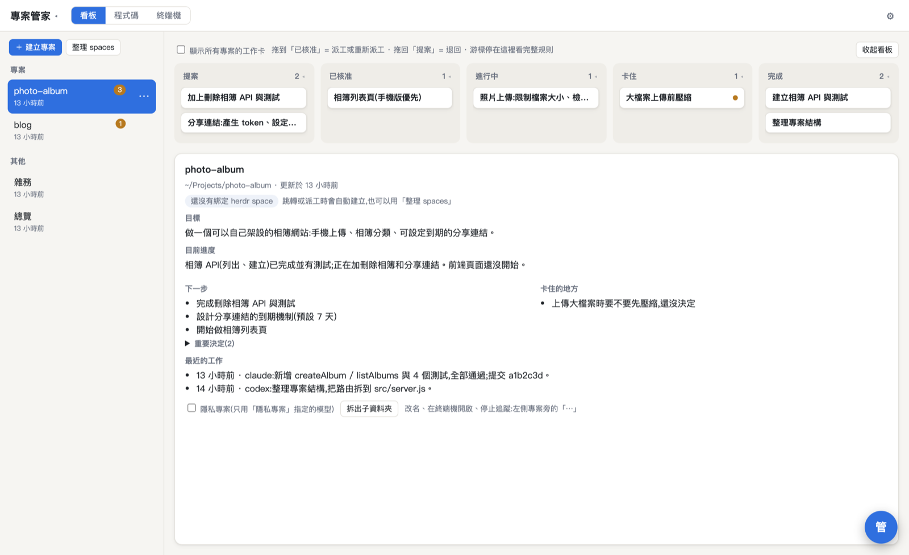
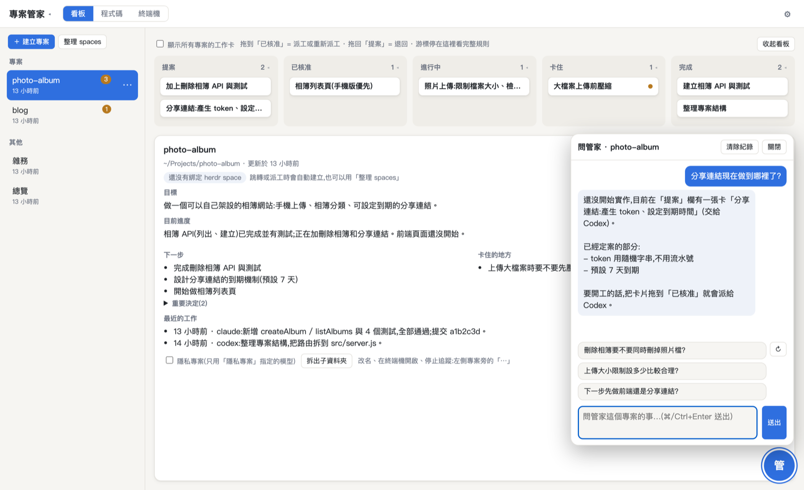
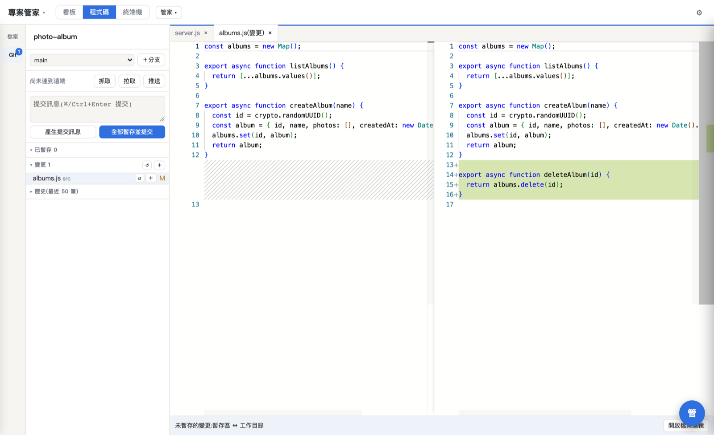
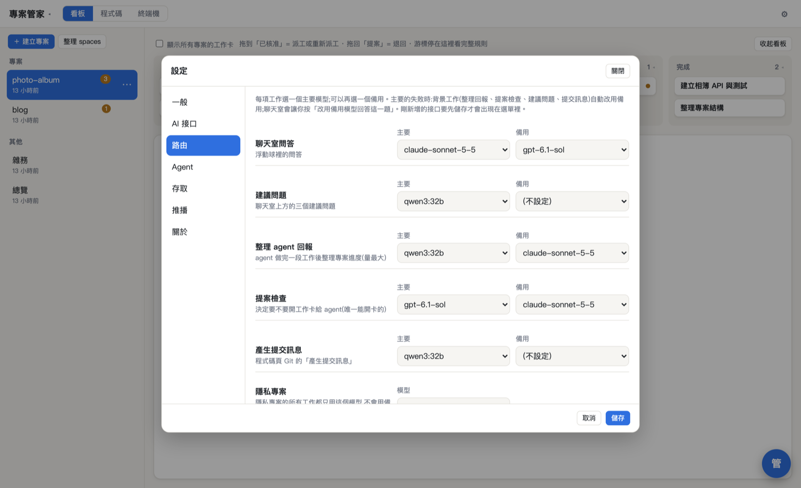
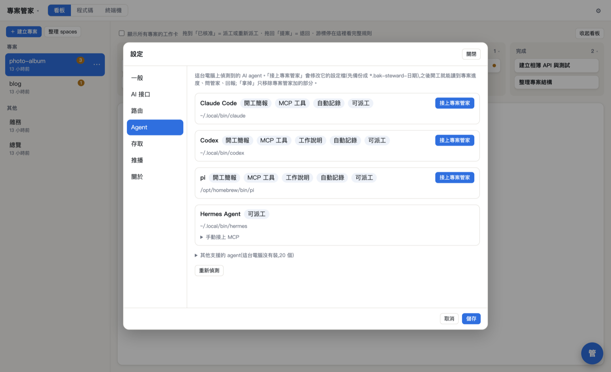
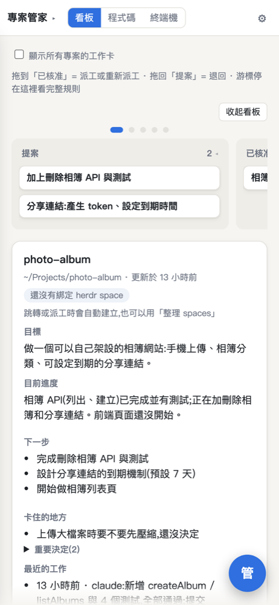

# agent-steward

[繁體中文](README.md)

When you juggle several AI coding agents (Claude Code, Codex, pi, opencode, Gemini CLI…) across several projects,
it is easy to lose track of where each project stands, who is doing what, and what is blocked. agent-steward:

- **Records progress automatically**: when an agent finishes a chunk of work, the steward reads its terminal output and keeps each project's goal, progress, next steps and blockers up to date.
- **Briefs agents on start**: an agent starting work in a project gets the latest state, so you don't have to repeat yourself.
- **Dispatches from a kanban board**: the steward proposes work cards; drag one to "Approved" and it opens a terminal and hands the task to the chosen agent.
- **Answers questions**: a floating chat button lets you ask "where is this project at?" any time.
- **Works in the browser**: board, code (editor, Git, diff) and terminal in one web page, usable from phones and tablets.



| Ask the steward | Code and Git |
|---|---|
|  |  |

| AI providers and routing | Detect and connect agents | Mobile |
|---|---|---|
|  |  |  |

> The UI is currently Traditional Chinese only.

## Install

**macOS / Linux** (terminal):

```sh
curl -fsSL https://raw.githubusercontent.com/hao-github-0216/agent-steward/main/install.sh | sh
```

**Windows** (PowerShell, no administrator rights needed):

```powershell
irm https://raw.githubusercontent.com/hao-github-0216/agent-steward/main/install.ps1 | iex
```

The installer opens `http://127.0.0.1:8791/` with a first-run wizard:

1. What the steward should call you
2. Connect at least one AI provider (paste an API key, or enter a self-hosted model URL)
3. Pick the agents to connect
4. (Optional) Set an admin password and enable Tailscale or LAN access to use it from your phone

What gets installed:

| Item | Location |
|---|---|
| App, settings, data | `~/.agent-steward/` |
| `steward` command | `~/.local/bin/steward` (Windows: `steward.cmd`) |
| Node.js 22.6+ | Downloaded to `~/.agent-steward/node` if missing (Homebrew on macOS when available) |
| [herdr](https://github.com/hao-github-0216/herdr) (terminal multiplexer with agent detection) | `~/.agent-steward/bin/`; an existing herdr install is left alone |
| [ttyd](https://github.com/tsl0922/ttyd) (web terminal) | Homebrew or `~/.agent-steward/bin/` |
| Start on login | launchd (macOS), systemd --user (Linux), Task Scheduler (Windows) |

## Update and uninstall

- **Update**: Settings → 關於 (About) → check for updates → update. Or run the install command again.
- **Uninstall** (keeps your data; add `--purge` / `-Purge` to delete it too):

  ```sh
  sh ~/.agent-steward/app/uninstall.sh
  ```

  ```powershell
  powershell -ExecutionPolicy Bypass -File $HOME\.agent-steward\app\uninstall.ps1
  ```

  Uninstalling first removes what the steward added to each agent's config files.

## AI providers and routing

The steward uses AI itself: answering questions, digesting agent reports, deciding what to propose, writing commit messages. Under Settings → AI 接口 you can add:

- Cloud providers: OpenAI, Anthropic, Google Gemini, OpenRouter, DeepSeek, Groq, Mistral, xAI (API key)
- Any OpenAI-compatible endpoint: Ollama, LM Studio, vLLM, your own server…
- If you use [pi](https://www.npmjs.com/package/@earendil-works/pi-coding-agent), reuse its logins and model configuration

Under Settings → 路由 (routing), pick a primary and fallback model for each job (e.g. cloud for chat, a local model for digests).
**Private projects** (or anything under a private folder) only ever use the model you designate.

## Supported agents

Fully automatic (start-of-work brief, MCP tools, progress recording): **Claude Code, Codex, pi, opencode, Gemini CLI, Qwen Code**.
Cursor, GitHub Copilot CLI and Amp get MCP automatically; the other agents herdr recognizes (24 in total) can be connected via a manual MCP snippet and can receive dispatched work.
Config files are backed up as `*.bak-steward-YYYYMMDD` before any change.

## Remote access and security

- Listens on `127.0.0.1` only by default; until you set an admin password, only this computer can use it.
- **Tailscale**: sets up `tailscale serve` for HTTPS; your own personal devices on your tailnet skip the password.
- **LAN**: requires the admin password; devices on the same network log in with it.
- The web terminal and code view can read and write your files. Only expose them to your own devices.

## Development

```sh
git clone https://github.com/hao-github-0216/agent-steward
cd agent-steward && npm install
# after committing, deploy locally (same install.sh, skips the herdr download)
sh scripts/deploy.sh
```

Node.js with TypeScript run directly via `--experimental-strip-types` (no build step); the web UI is a single HTML file.
herdr comes from [hao-github-0216/herdr](https://github.com/hao-github-0216/herdr): upstream [herdrdev/herdr](https://github.com/herdrdev/herdr) plus a folder navigator and other changes.

## License

[MIT](LICENSE)
