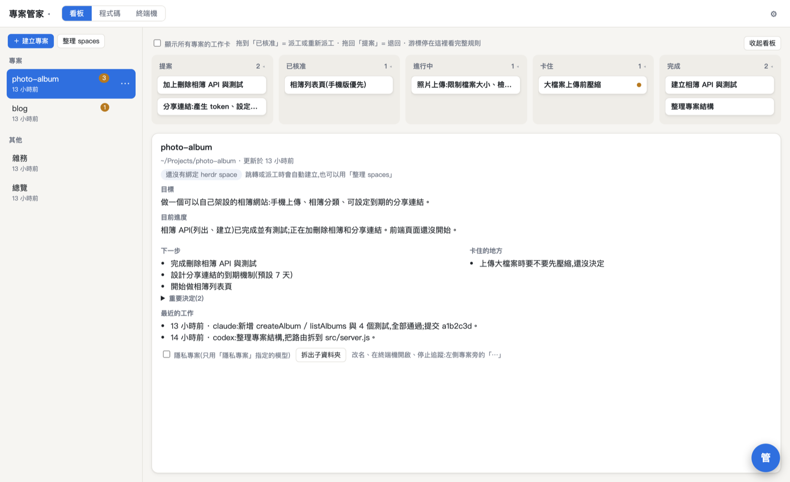
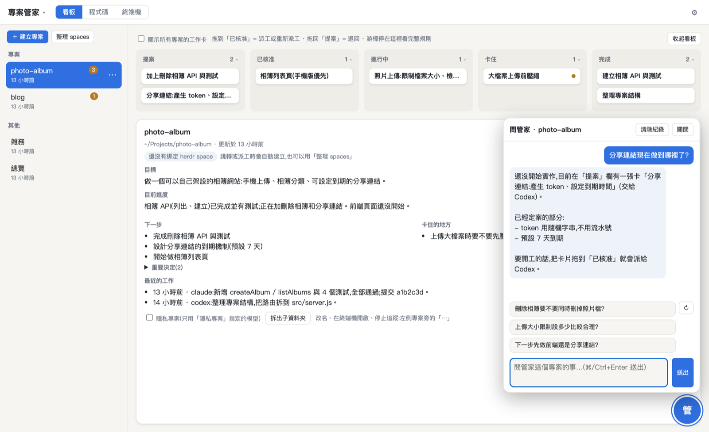
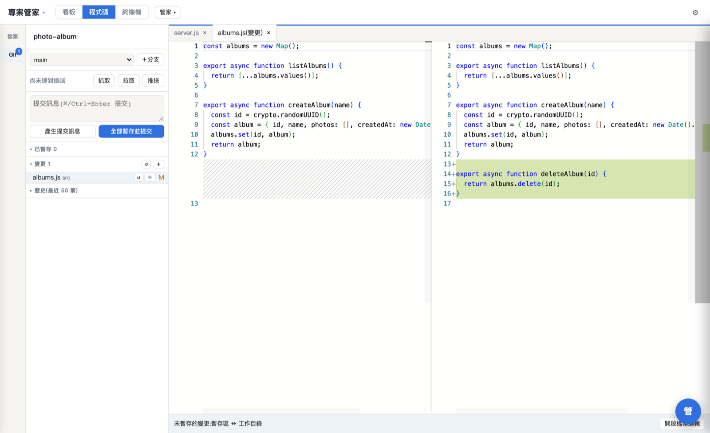
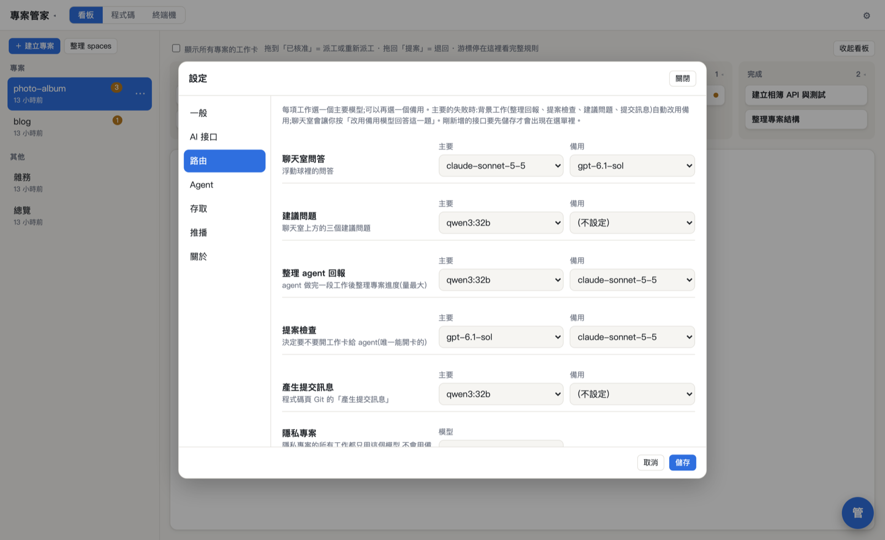
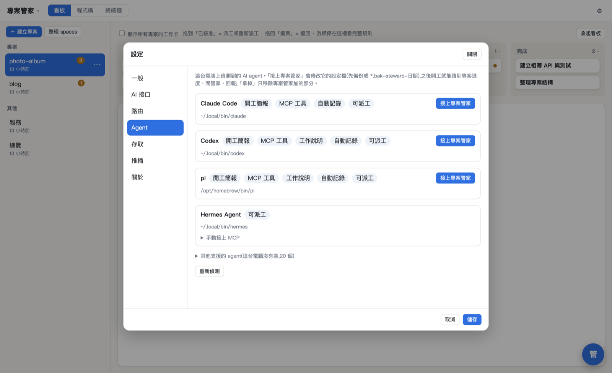
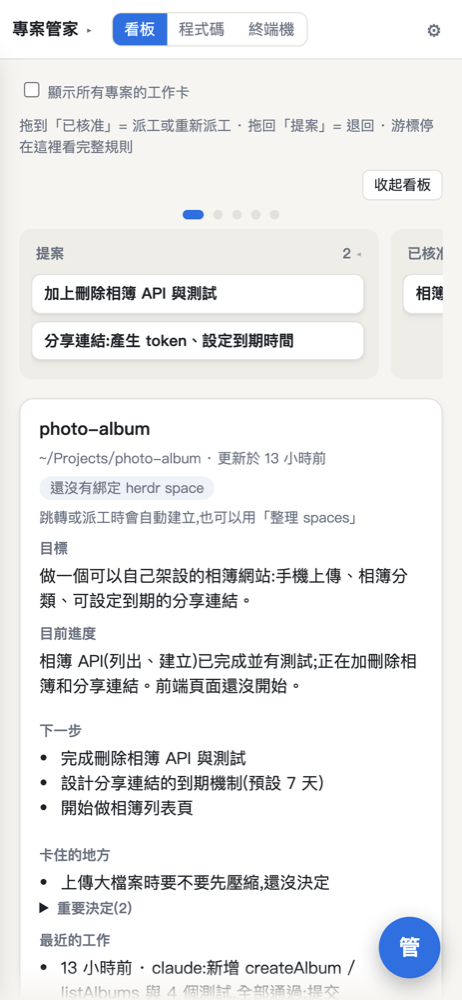

# agent-steward

[繁體中文](README.md)

When you juggle several AI coding agents (Claude Code, Codex, pi, opencode, Gemini CLI…) across several projects,
it is easy to lose track of where each project stands, who is doing what, and what is blocked. agent-steward:

- **Records progress automatically**: when an agent finishes a chunk of work, the steward reads its terminal output and keeps each project's goal, progress, next steps and blockers up to date.
- **Briefs agents on start**: an agent starting work in a project gets the latest state, so you don't have to repeat yourself.
- **Dispatches from a kanban board**: the steward proposes work cards; drag one to "Approved" and it opens a terminal and hands the task to the chosen agent. Once a card is done (or stuck), you can **ask follow-up questions** right in the card; they go to the agent that did the work, and the questions and full replies stay as a thread.
- **Periodic patrol**: the steward regularly looks through each project's repo for outdated docs, files that have stayed out of version control for a long time, failed CI runs and stale blockers, and turns what it finds into proposed cards. Nothing is dispatched until you approve a card. A patrol only reads; it never changes files, and private projects are skipped. Turn it on or off, set the interval and pick the checks in Settings → Agent. To patrol the current project right away, run `steward patrol` in a terminal.
- **Answers questions**: a floating chat button lets you ask "where is this project at?" any time.
- **Works in the browser**: board, code (editor, Git, diff, previews) and terminal in one web page, usable from phones and tablets. An HTML file can be previewed to the side. The preview loads CSS, images and fonts from the same project, but it does not run JavaScript.

Periodic patrol and HTML preview were added after v0.4.0, so the released v0.4.0 doesn't have them yet.



| Ask the steward | Code and Git |
|---|---|
|  |  |

| AI providers and routing | Detect and connect agents | Mobile |
|---|---|---|
|  |  |  |

## Install

Agent Steward ships as a desktop App for Mac and Windows. There is no Linux version at the moment.

Download the file for your system from [Releases](https://github.com/hao-github-0216/agent-steward/releases/latest) (`vX.Y.Z` is the version number):

| System | File |
|---|---|
| macOS 13.5 or later (Apple Silicon and Intel) | `agent-steward-desktop-vX.Y.Z-macos-universal.dmg` |
| Windows 10 or later (x64) | `agent-steward-desktop-vX.Y.Z-windows-x64-setup.exe` |

- **Mac**: open the .dmg, drag Agent Steward into Applications, and open it from there. The App is signed with an Apple Developer ID and notarized by Apple, so macOS opens it without a warning.
- **Windows**: run the setup .exe. The App installs to `C:\Program Files\Agent Steward` for every account on the computer, so Windows shows a User Account Control prompt. Click "Yes" to continue. The installer uses your system language.
  - The installer isn't code-signed yet, so Windows shows "Windows protected your PC". Click "More info", then "Run anyway". The User Account Control prompt also shows the publisher as "Unknown".
  - Your browser may also warn that the file isn't commonly downloaded. Choose to keep it.
  - If an older version is installed in your user folder, the installer removes it first. Your settings and data are kept.
  - To check that the file hasn't been tampered with first, see [How downloads are verified](#how-downloads-are-verified) below.

The App has no window and doesn't appear in the Dock or the taskbar. When it starts, an icon appears in the Mac menu bar (on Windows, in the system tray at the bottom right), and your default browser opens `http://127.0.0.1:8791/`. To open it again later, click the icon and choose "Open Agent Steward".

The first time, a setup wizard walks you through these steps:

1. What the steward should call you
2. Components and background, which asks three separate questions:
   - Whether to make the `herdr` command available in your terminal
   - Whether to add the herdr shortcut and plugins (this changes herdr's `config.toml`)
   - Whether to start at login
3. Connect at least one AI provider (paste an API key, or enter the URL of a self-hosted model)
4. Choose which agents to connect to the steward
5. (Optional) Turn on plugins, such as LaTeX builds or Jupyter
6. (Optional) Set an admin password and turn on Tailscale or LAN access to connect from your phone

The App bundles Node.js, [herdr](https://github.com/hao-github-0216/herdr) (terminal multiplexer and agent status detection), and [ttyd](https://github.com/tsl0922/ttyd) (web terminal), so you don't need to install anything else. Settings and data live in `~/.agent-steward/`.

**If you used the one-line install before**: the one-line install has been discontinued, and installations made with it no longer get updates. Please switch to the desktop App. The first time the App opens, it detects the old background services and asks whether the App should take over.

- "Let the App manage it": your settings and data are kept. The old background services are disabled and removed, and the old program files are left in place.
- "Quit App": nothing changes, and the existing installation keeps running.

### Can the program files be changed?

Agent Steward is open source under the MIT license. The code inside the App is readable JavaScript, the same as on GitHub. The App protects the program files from accidental changes in two ways:

- **They live where a normal account can't write.** On a Mac, the code is inside the signed App, and macOS notices if it changes. On Windows, the code is in `C:\Program Files`, which needs administrator rights to modify.
- **Checksums are compared after startup.** The steward compares the SHA-256 of every program file with the official release in the background. If anything differs, Settings → About shows a notice with a button to download the same version again. The steward keeps running and doesn't block you.

When you report a problem, the diagnostics from `/api/health` include an `integrity` field that shows whether the program files were changed.

### How downloads are verified

- The components bundled in the App use pinned versions, and their SHA-256 is checked during packaging. Versions and checksums live in [`components.json`](components.json). Licenses are listed in [THIRD_PARTY_NOTICES.md](THIRD_PARTY_NOTICES.md).
- Each release on the [Releases](https://github.com/hao-github-0216/agent-steward/releases) page includes the installers, plus `SHA256SUMS` and a GitHub artifact attestation. To check them yourself:

  ```sh
  gh release download vX.Y.Z -R hao-github-0216/agent-steward
  sha256sum -c SHA256SUMS        # on macOS: shasum -a 256 -c SHA256SUMS
  gh attestation verify agent-steward-desktop-vX.Y.Z-macos-universal.dmg -R hao-github-0216/agent-steward
  ```

  Attestations are checked one file at a time. To check the Windows installer, run `gh attestation verify` again with its file name.
- On Windows without `sha256sum`, compute the checksum in PowerShell and compare it with the line for the same file name in `SHA256SUMS`:

  ```powershell
  Get-FileHash .\agent-steward-desktop-vX.Y.Z-windows-x64-setup.exe -Algorithm SHA256
  ```

- For the Mac .dmg, you can also check the Apple signature and notarization:

  ```sh
  spctl -a -vv -t open --context context:primary-signature agent-steward-desktop-vX.Y.Z-macos-universal.dmg
  xcrun stapler validate agent-steward-desktop-vX.Y.Z-macos-universal.dmg
  ```

- agent-steward sends no usage data. Phone notifications (only if you allow them in the mobile app) are encrypted and pass through a push relay run by the developer, which cannot read them. See the [privacy policy](docs/privacy.en.md).

## Language

The web interface, the Windows installer, and the App menus are available in 繁體中文 and English. They all start in your system's language, and the web interface follows the same setting. To switch, go to Settings → General → Language. The page reloads in the new language.

The language also applies to what the steward writes from then on: progress notes, briefs, suggested questions, and notifications. Notes written before the switch stay in their original language. Your own cards, chats, and files are never translated.

## Update and uninstall

- **Update**: from v0.4.0, the App checks for new versions itself.
  - It checks a few minutes after it starts, then once a day. When a new version is out, it asks first, and it downloads and installs only after you click "Update".
  - Every update file must pass an update-signature check before it's installed. Only then does the App stop the services, install the new version, and restart itself. The web terminal disconnects once, and agents in herdr keep running.
  - On Windows, updates need administrator rights, so a User Account Control prompt appears before installing. Click "Yes" to continue.
  - On Windows, if herdr is running, the update has to close all terminals and agents. The App explains this and asks first, so you can choose "Later" and update once your work is done.
  - You can also check by hand from "Check for updates…" in the menu or Settings → About. Settings → General turns off automatic checks.
  - v0.3.0 doesn't have this yet, so install v0.4.0 by hand once: quit Agent Steward from the menu, then install the new version with the steps above (on a Mac, replace the old copy in Applications). Your settings and data are kept.
- **Uninstall**:
  1. To also remove what the steward added to each agent's config files, disconnect each agent first in Settings → Agent. If you turned on Tailscale or LAN access, turn it off in Settings → Access.
  2. Uncheck "Start at login" in the menu, then quit Agent Steward. If you skip this, the login item setting stays behind on your system.
  3. Mac: drag Agent Steward from Applications to the Trash. Windows: Settings → Apps → Installed apps → Agent Steward → Uninstall.
  4. Your settings and data stay in `~/.agent-steward/`. The `~/.local/bin/steward` command the App created (`steward.cmd` on Windows), and the `herdr` command if you agreed to it, also stay. Delete them yourself if you don't need them.

## AI providers and routing

The steward uses AI itself: answering questions, digesting agent reports, deciding what to propose, writing commit messages. Under Settings → AI providers you can add:

- Cloud providers: OpenAI, Anthropic, Google Gemini, OpenRouter, DeepSeek, Groq, Mistral, xAI (API key)
- Any OpenAI-compatible endpoint: Ollama, LM Studio, vLLM, your own server…
- If you use [pi](https://www.npmjs.com/package/@earendil-works/pi-coding-agent), reuse its logins and model configuration

Under Settings → Routing, pick a primary and fallback model for each job (e.g. cloud for chat, a local model for digests).
**Private projects** (or anything under a private folder) only ever use the model you designate.

## Supported agents

Fully automatic (start-of-work brief, MCP tools, progress recording): **Claude Code, Codex, pi, opencode, Gemini CLI, Qwen Code**.
Cursor, GitHub Copilot CLI and Amp get MCP automatically; the other agents herdr recognizes (24 in total) can be connected via a manual MCP snippet and can receive dispatched work.
Config files are backed up as `*.bak-steward-YYYYMMDD` before any change.

## Remote access and security

- Listens on `127.0.0.1` only by default; until you set an admin password, only this computer can use it.
- **Tailscale**: sets up `tailscale serve` for HTTPS; your own personal devices on your tailnet skip the password.
- **LAN**: requires the admin password; devices on the same network log in with it.
- The web terminal and code view can read and write your files. Only expose them to your own devices.

## Development

```sh
git clone https://github.com/hao-github-0216/agent-steward
cd agent-steward && npm install
# after committing, deploy to the local background service (developer-only scripts/dev/install.sh, skips the herdr download)
sh scripts/deploy.sh
```

Node.js with TypeScript run directly via `--experimental-strip-types` (no build step); the web UI is a single HTML file.
herdr comes from [hao-github-0216/herdr](https://github.com/hao-github-0216/herdr): upstream [herdrdev/herdr](https://github.com/herdrdev/herdr) plus a folder navigator and other changes.

## License

[MIT](LICENSE). Components bundled in the App keep their own licenses; see [THIRD_PARTY_NOTICES.md](THIRD_PARTY_NOTICES.md).
