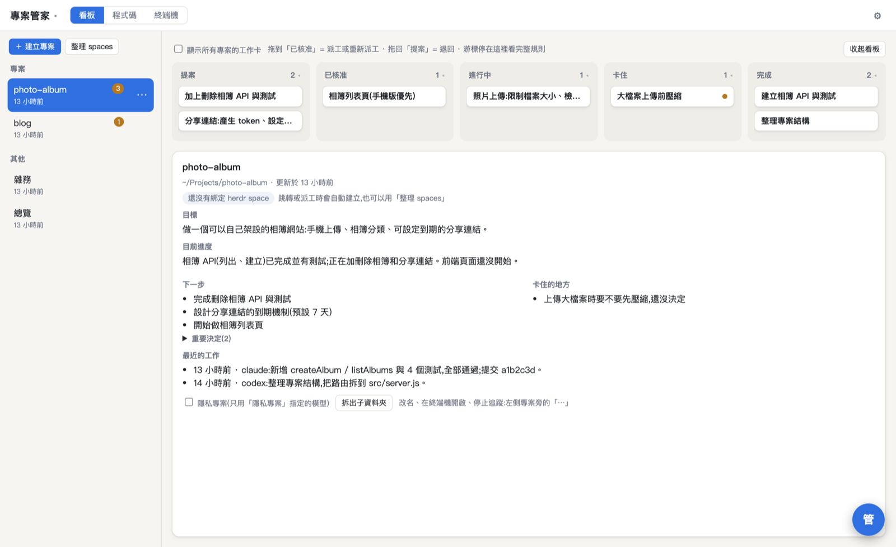
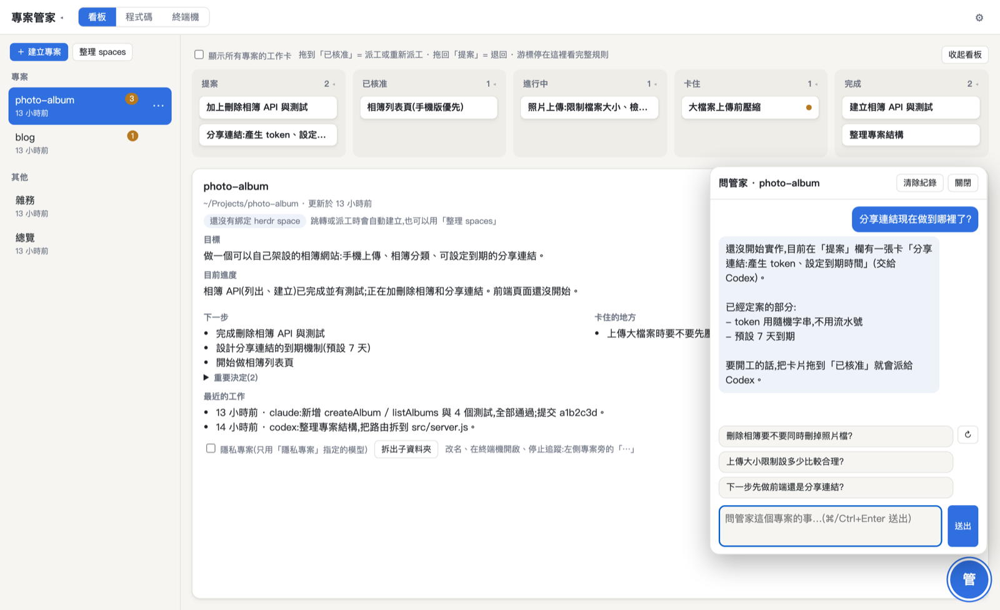
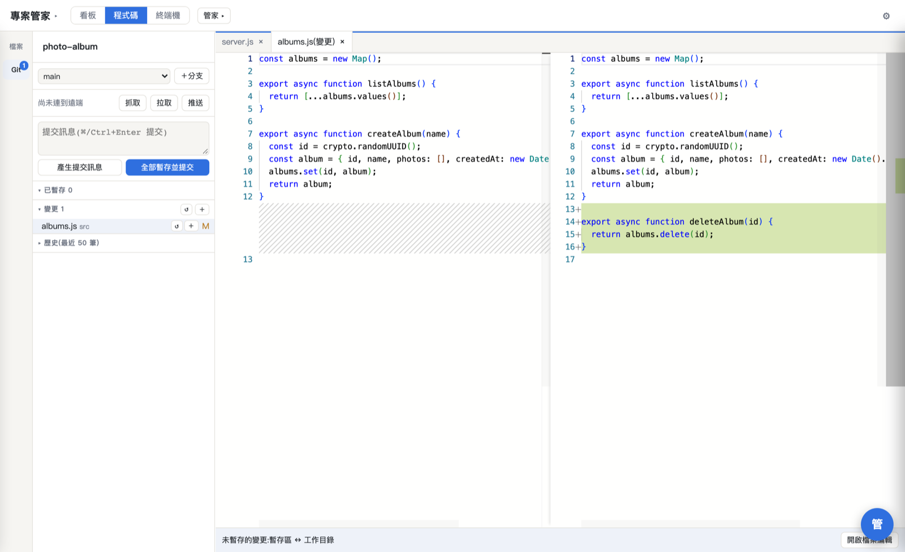
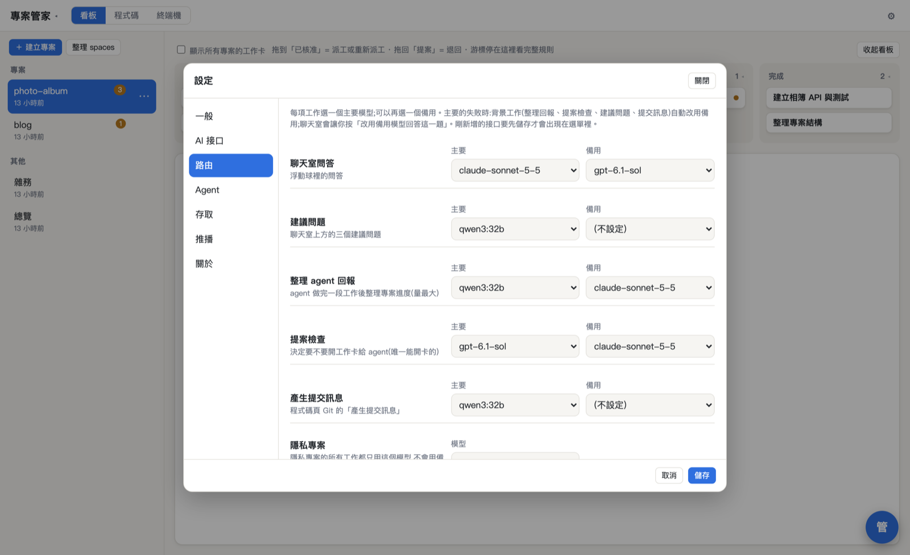
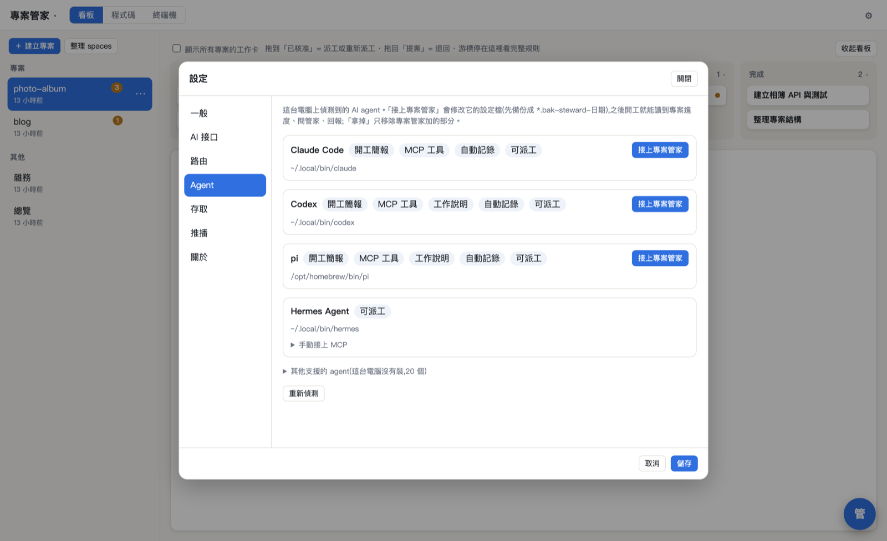
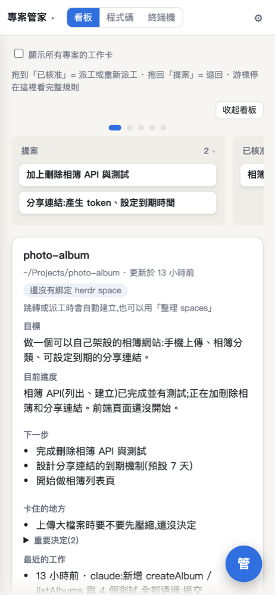

# 專案管家 agent-steward

[English](README.en.md)

同時用好幾個 AI coding agent(Claude Code、Codex、pi、opencode、Gemini CLI…)做好幾個專案時,
很容易忘記每個專案做到哪、誰在做什麼、哪裡卡住。專案管家會:

- **自動記錄進度**:agent 做完一段工作,管家讀它的終端機輸出,整理成每個專案的目標、進度、下一步、卡住的地方。
- **開工簡報**:agent 一開工就讀到這個專案的最新狀態,不用每次重講。
- **看板派工**:管家發現該做的事會提案成工作卡;你拖到「已核准」,它就開一個終端機把工作交給指定的 agent。做完(或卡住)後可以在卡片裡**接著追問**做這張卡的 agent,問題和完整回覆排成一串對話。
- **問管家**:右下角的浮動球,隨時問「這個專案做到哪了?」。
- **網頁上就能工作**:看板、程式碼(編輯、Git、比對)、終端機都在同一個網頁,手機和平板也能用。



| 問管家 | 程式碼與 Git |
|---|---|
|  |  |

| 自訂 AI 接口與路由 | 偵測並接上 agent | 手機 |
|---|---|---|
|  |  |  |

> 網頁介面目前只有繁體中文。安裝程式和桌面 App 的選單可以選繁體中文或 English。

## 安裝

有兩種裝法，裝好之後用起來一樣，同一台電腦選一種就好：

- **桌面 App**（Mac、Windows）：下載安裝檔，點兩下就能用，不用打指令。
- **一行安裝指令**（macOS、Linux、Windows）：在終端機貼一行指令。Linux 目前只有這種裝法。

### 桌面 App

到 [Releases](https://github.com/hao-github-0216/agent-steward/releases/latest) 下載你的系統用的檔案（`vX.Y.Z` 是版本號）：

| 系統 | 檔案 |
|---|---|
| macOS 13.5 以上（Apple Silicon、Intel 都適用） | `agent-steward-desktop-vX.Y.Z-macos-universal.dmg` |
| Windows 10 以上（x64） | `agent-steward-desktop-vX.Y.Z-windows-x64-setup.exe` |

- **Mac**：打開 .dmg，把 Agent Steward 拖進「應用程式」，再從「應用程式」打開。App 有 Apple 的 Developer ID 簽章，也通過 Apple 公證，打開時不會被擋下來。
- **Windows**：執行 setup.exe。一開始可以選語言（繁體中文 / English），會裝給目前的使用者，不需要系統管理員。
  - 安裝檔沒有程式碼簽章，所以 Windows 會跳出「Windows 已保護您的電腦」。按「其他資訊」，再按「仍要執行」。
  - 瀏覽器下載時也可能提醒這個檔案不常被下載，選擇保留就可以。
  - 想先確認檔案沒被動過，見下面的[下載的東西怎麼驗證](#下載的東西怎麼驗證)。

App 沒有視窗，也不會出現在 Dock 或工作列。打開後，Mac 的選單列（Windows 是右下角的系統匣）會出現一個圖示，同時用預設瀏覽器打開 `http://127.0.0.1:8791/`。之後要打開畫面，點這個圖示選「打開專案管家」。

第一次打開會走設定精靈，內容和[一行安裝](#一行安裝指令)相同，另外多一步「元件與背景執行」，分開問三件事：

- 要不要在終端機也能用 `herdr` 指令
- 要不要加上 herdr 的快捷鍵與外掛（會修改 herdr 的 `config.toml`）
- 要不要登入時自動啟動

App 內附 Node.js、herdr 和 ttyd，不用另外安裝。設定與資料和一行安裝一樣，放在 `~/.agent-steward/`。

**已經用一行指令裝過的話**：App 第一次打開時會偵測到舊的背景服務，問你要不要改由 App 管理。

- 選「改由 App 管理」：設定與資料都保留，舊的背景服務會停用並移除，舊的程式檔先留著。
- 選「結束 App」：什麼都不改，舊的安裝照常執行。

### 一行安裝指令

**macOS / Linux**（終端機）：

```sh
curl -fsSL https://github.com/hao-github-0216/agent-steward/releases/latest/download/install.sh | sh
```

**Windows**（PowerShell，不需要系統管理員）：

```powershell
irm https://github.com/hao-github-0216/agent-steward/releases/latest/download/install.ps1 | iex
```

安裝程式不會一執行就動手。它會先問語言（繁體中文 / English），列出這次會做的事，再讓你選「開始 / 自訂 / 取消」。列出的內容包括：

- 會下載什麼：版本、大小、來源與授權
- 會放東西的地方
- 會修改哪些其他程式的設定（例如 herdr 的快捷鍵）
- 登入時自動啟動的服務名稱
- 只聽哪些網路位址
- 怎麼移除

選「自訂」可以關掉不需要的部分：herdr、網頁終端機、herdr 快捷鍵與外掛、登入時自動啟動、裝完打開瀏覽器。Windows 另外可以選要不要加進 PATH。

常用選項。Windows 用 `irm | iex` 時無法帶參數，改用括號裡的環境變數：

| 選項 | 作用 |
|---|---|
| `--dry-run`（`STEWARD_DRY_RUN=1`） | 只列出計畫，什麼都不做 |
| `--yes`（`STEWARD_YES=1`） | 不詢問，照預設安裝。沒有終端機可以詢問時一定要加 |
| `--without=terminal,autostart`（`STEWARD_WITHOUT`） | 不裝指定的部分 |
| `--lang en`（`STEWARD_LANG`） | 指定訊息語言 |

例如只想先看計畫：`curl -fsSL …/install.sh | sh -s -- --dry-run`

裝完會打開瀏覽器（`http://127.0.0.1:8791/`），跟著第一次設定精靈走：

1. 管家怎麼稱呼你
2. 接上至少一個 AI 接口（貼 API 金鑰，或填自架模型的網址）
3. 勾選要接上專案管家的 agent
4. （選用）設定管理密碼、開啟 Tailscale 或區網存取，用手機連進來

安裝程式會準備好：

| 項目 | 位置 |
|---|---|
| 程式、設定、資料 | `~/.agent-steward/` |
| `steward` 指令 | `~/.local/bin/steward`（Windows：`steward.cmd`） |
| Node.js | 電腦上已有 22.6 以上就沿用；沒有就下載 Node.js 24 到 `~/.agent-steward/node`。Mac 可以在「自訂」改用 Homebrew |
| [herdr](https://github.com/hao-github-0216/herdr)（終端機多工、agent 狀態偵測） | `~/.agent-steward/bin/`；已經自己裝了 herdr 不會覆蓋 |
| [ttyd](https://github.com/tsl0922/ttyd)（網頁終端機） | macOS 用 Homebrew；Linux、Windows 下載到 `~/.agent-steward/bin/` |
| 登入時自動啟動 | macOS launchd、Linux systemd --user、Windows 工作排程器 |
| 安裝收據 | `~/.agent-steward/install.json`：記下你的選擇和每一項改動，更新時沿用、移除時照著還原 |

### 下載的東西怎麼驗證

- 每個下載的檔案都固定版本，使用前比對 SHA-256，不符就停止安裝。版本與檢查碼記在 [`components.json`](components.json)，各元件的授權見 [THIRD_PARTY_NOTICES.md](THIRD_PARTY_NOTICES.md)。
- 每個版本的安裝程式和程式壓縮檔都附在 [Releases](https://github.com/hao-github-0216/agent-steward/releases)，並附上 `SHA256SUMS` 和 GitHub 的來源證明（artifact attestation）。想自己核對的話：

  ```sh
  gh release download vX.Y.Z -R hao-github-0216/agent-steward
  sha256sum -c SHA256SUMS        # macOS 用 shasum -a 256 -c SHA256SUMS
  gh attestation verify agent-steward-vX.Y.Z.tar.gz -R hao-github-0216/agent-steward
  ```

- 桌面 App 的兩個安裝檔也列在 `SHA256SUMS` 裡，`sha256sum -c` 會一起核對。來源證明要一個檔案一個檔案驗，把上面 `gh attestation verify` 的檔名換掉再跑一次就可以。
- Windows 上沒有 `sha256sum` 的話，用 PowerShell 算出檢查碼，再和 `SHA256SUMS` 裡同一個檔名的那一行比對：

  ```powershell
  Get-FileHash .\agent-steward-desktop-vX.Y.Z-windows-x64-setup.exe -Algorithm SHA256
  ```

- Mac 的 .dmg 還可以確認 Apple 簽章與公證：

  ```sh
  spctl -a -vv -t open --context context:primary-signature agent-steward-desktop-vX.Y.Z-macos-universal.dmg
  xcrun stapler validate agent-steward-desktop-vX.Y.Z-macos-universal.dmg
  ```

- 要固定裝某一版，把網址裡的 `latest/download` 換成 `download/vX.Y.Z`。
- 專案管家和安裝程式都不會傳送任何使用資料。

## 更新與移除

- **更新（一行安裝）**：設定 → 關於 → 檢查更新 → 「更新到 vX.Y.Z」。按下去會先跳確認視窗，說明會下載什麼。也可以再跑一次安裝指令。更新時沿用上次的選擇，你自己拿掉的設定不會加回來。
- **更新（桌面 App）**：v0.4.0 起，App 會自己檢查新版。
  - App 啟動幾分鐘後檢查一次，之後每天一次。有新版時會先問你，按「更新」才會下載和安裝。
  - 每個更新檔都要通過更新簽章的驗證才會安裝。驗證通過後，App 才會停下服務、裝好新版、自己重開。網頁終端機會斷線一次，herdr 裡的 agent 會繼續跑。
  - Windows 上如果 herdr 正在跑，更新需要關閉所有終端機和 agent，App 會先說明再問你。可以選「稍後」，等手上的工作做完再更新。
  - 也可以從選單的「檢查更新…」或 設定 → 關於 手動檢查。設定 → 一般 可以關掉自動檢查。
  - v0.3.0 還沒有這個功能，要手動下載 v0.4.0 裝一次：先從選單結束專案管家，再照上面的安裝步驟裝新版（Mac 直接覆蓋「應用程式」裡的舊版）。設定與資料都會保留。
- **移除（一行安裝）**（資料會保留，加 `--purge` / `-Purge` 連資料一起刪）：

  ```sh
  sh ~/.agent-steward/app/uninstall.sh
  ```

  ```powershell
  powershell -ExecutionPolicy Bypass -File $HOME\.agent-steward\app\uninstall.ps1
  ```

  移除時會：
  - 拿掉各 agent 設定檔裡專案管家加的部分。
  - 照安裝收據還原安裝時做的改動，例如工作排程、PATH、linger。
  - 關掉轉到管家的 Tailscale Serve。

  安裝時留下的備份檔會列出來，由你決定要不要刪。

- **移除（桌面 App）**：
  1. 想把專案管家加進各 agent 設定檔的部分一起拿掉，先到 設定 → Agent 逐一拿掉。有開 Tailscale 或區網存取的話，也先到 設定 → 存取 關掉。
  2. 在選單取消勾選「登入時自動啟動」，再結束專案管家。沒有先取消的話，系統裡的登入項目設定會留下來。
  3. Mac：把「應用程式」裡的 Agent Steward 拖到垃圾桶。Windows：設定 → 應用程式 → 已安裝的應用程式 → Agent Steward → 解除安裝。
  4. 設定與資料還留在 `~/.agent-steward/`。App 建的 `~/.local/bin/steward`（Windows 是 `steward.cmd`），以及你同意時建的 `herdr` 指令也還在。不需要的話自己刪掉。

## AI 接口與路由

管家自己也會用 AI:回答問題、整理 agent 的回報、決定要不要提案、產生 Git 提交訊息。在「設定 → AI 接口」可以加:

- 雲端服務:OpenAI、Anthropic、Google Gemini、OpenRouter、DeepSeek、Groq、Mistral、xAI(貼 API 金鑰)
- 任何 OpenAI 相容的網址:Ollama、LM Studio、vLLM、自架伺服器…
- 已經在用 [pi](https://www.npmjs.com/package/@earendil-works/pi-coding-agent) 的話,可以直接沿用它的登入和模型設定

「設定 → 路由」可以替每項工作分別選主要和備用模型(例如聊天用雲端、整理回報用本地模型)。
**隱私專案**:標記為隱私的專案(或放在隱私資料夾底下的)只會用你指定的模型,內容不會送到其他地方。

## 支援的 agent

自動接上(開工簡報、MCP 工具、自動記錄):**Claude Code、Codex、pi、opencode、Gemini CLI、Qwen Code**;
Cursor、GitHub Copilot CLI、Amp 自動接 MCP;其他 herdr 認得的 agent(共 24 種)可以手動接 MCP、也能被派工。
接上時會修改該 agent 的設定檔,修改前會先備份成 `*.bak-steward-日期`。

## 遠端存取與安全

- 預設只聽本機(`127.0.0.1`),還沒設管理密碼時只有這台電腦能用。
- **Tailscale**:開啟後自動設定 `tailscale serve`,經 HTTPS 連進來;你自己帳號的個人裝置免密碼。
- **區網**:要先設管理密碼,同一個 Wi-Fi 的裝置用密碼登入。
- 網頁終端機和程式碼頁能讀寫你的檔案,請只開放給自己的裝置。

## 開發

```sh
git clone https://github.com/hao-github-0216/agent-steward
cd agent-steward && npm install
# 改完 commit 後部署到本機(跟一般安裝走同一套 install.sh,不會下載 herdr)
sh scripts/deploy.sh
```

程式是 Node.js(TypeScript,直接用 `--experimental-strip-types` 執行,不需要編譯),網頁是單一 HTML。
`herdr` 用的是 [hao-github-0216/herdr](https://github.com/hao-github-0216/herdr),上游 [herdrdev/herdr](https://github.com/herdrdev/herdr) 加上資料夾導覽等修改。

## 授權

[MIT](LICENSE)。安裝程式另外下載的元件各自沿用原本的授權，見 [THIRD_PARTY_NOTICES.md](THIRD_PARTY_NOTICES.md)。
